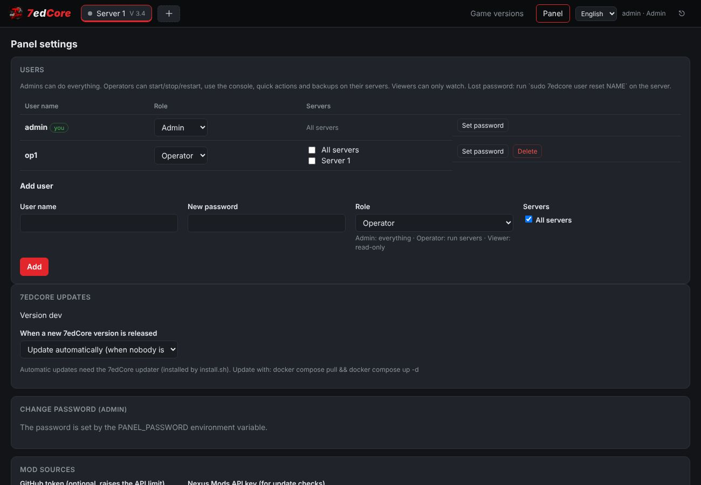

<p align="center"></p>

<p align="center"><b>A self-hosted web panel for 7 Days to Die dedicated servers.</b><br>
Several servers on one machine, each with its own game version, mods, backups and schedule.</p>

<p align="center">
  <a href="https://github.com/Koberecnikos/7edCore/actions"></a>
  <a href="https://github.com/Koberecnikos/7edCore/releases"></a>
</p>

---

## Features

### Servers
- **Several servers on one machine.** Each server has its own tab, ports, saves, mods, backups, schedule and settings. Add one with **＋**. A new server can copy the settings of an existing one.
- **Game version per server.** Run any Steam branch: `public`, `v3.4.0`, `v2.6`, `alpha21.2`, experimental and so on. Installs are shared between servers and managed on the **Game versions** page (install, update, verify, remove).
- **Save compatibility checks.** 7edCore records the game version each save was made with. It warns before you load a save on a newer version, and it blocks a major-version jump or a downgrade unless you confirm.
- **Overview.** Players, in-game time, world, CPU and RAM of the server and the machine, server FPS, chunks, zombies, CPU temperature, disk, ports, last backup and the web map link.
- **Quick actions.**
  - Save the world, back up now, or message players.
  - Restart or stop with an in-game countdown (cancellable).
  - Update the game, the mods, or both.
  - Check for updates and enable the web map.
  - **Start automatically when the machine starts.**
- **Live console** with commands. **Player list** with kick, ban and promote to admin.
- **Web map.** Turn on the game's web dashboard with one click and open the map from the panel. Every server has its own map port.

### Game settings
- **Three levels.** Basic covers world, difficulty, players and party XP range. Detailed has every gameplay option by category. Advanced covers networking, permissions and admin interfaces.
- **V3 Sandbox Options.** All 165 options are editable directly, with labels and descriptions, so no external code generator is needed. You can paste or copy the `SandboxCode`. Older game versions use the classic `serverconfig.xml` settings.
- **Raw editor** for `serverconfig.xml`, with XML validation and an automatic `.bak`.

### Difficulty presets
More than 50 presets. Each one opens a preview that lists every change before anything is applied.

| Group | Presets |
|---|---|
| **Game difficulty** (exact values from the PC game) | Scavenger, Adventurer, Nomad, Warrior, True Survivalist, Insane, Standard (reset) |
| **Zombies** (only zombies: health, damage, speed, senses, rage, block damage, density) | Easy, Medium, Hard, Extreme |
| **Survival** (food, water, infection, gear wear, traders, death; XP stays generous so it never becomes a grind) | Easy, Medium, Hard, Extreme |
| **Weapons & loot** | Gun Nut, Scavenged Arsenal (rare high-quality guns from day one that cannot be repaired), Disposable Guns, Ammo Famine |
| **World threat** (game stage and spawns) | Quiet Countryside, Infested Cities, Wasteland Everywhere (tougher zombie types outside their biomes), Elite Apocalypse |
| **Challenges** | Weekend Survivor, Loot Goblin, Bookworm, Builder's Paradise, Party Mode, Night Terrors, Horde Week, Siege Builders, Short Fuse, Black Market, Lost Knowledge, Feral Wasteland, Lootbag Only, Stone Age, Hardcore Survivor, Insane Apocalypse |
| **Official presets of The Fun Pimps** (exact codes) | Almost Creative, Chibi Mode, Dumpster Diver, Legacy Survival, Disaster Film, Caveman Life, Dying World, Undead Matinee, Seven days Later, Madmoles Mayhem, Bite Club |

- **Combine presets.** Add presets with **＋** and drag them into order in the side panel. The one on top wins wherever two presets set the same option. A typical stack is *Insane + Zombies: Extreme + Survival: Hard + Scavenged Arsenal*. The preview shows which preset each change comes from and what was overridden.
- **Random challenge.** Pick Easy, Medium or Hard and get 3–5 balanced twists from a pool of 40. They can make the game harder, easier or just strange: sprinters, tough dead, black market, no repairs, moon gravity, headshots only and more. Reroll until you like it. Every roll has a seed, so it can be repeated.
- **Challenge modlets.** Some challenges need more than settings. *Lootbag Only*, for example, empties world containers, so 7edCore generates a small server-side XML modlet for them. Players do not install anything.

### Mods
- Install from a ZIP (drag and drop, with upload progress), a GitHub repository or a URL.
- **Find compatible version** picks the newest release made for your server's game version.
- Updates keep your edited config files. If the author changed the same file, their version is saved next to yours as `*.new`.
- Enable, disable or delete mods. Automatic or notify-only mod updates are set per server.

### Worlds and configs
- Choose a map, generate an RWG world (seed and size), or switch between saves. For each save you see the game version it was made with and last played with.
- **Import a world** from a ZIP, for example a single-player save from `%APPDATA%\7DaysToDie`.
- **Export and import a server config** (game settings, panel settings, admins), from your PC, from a file stored on the server, or from another server. Ports and data folders of the target server are kept.

### Automation
- **Scheduler.** Start, stop, restart, update-and-restart and backup rules per weekday, with in-game chat warnings before the action.
- **Updates.**
  - Game updates: off, notify, hotfixes, or hotfixes plus minor updates. Major updates are never automatic.
  - Mod updates: off, notify or auto.
  - When to install: only when nobody is online, only while stopped, or at the next scheduled restart.
  - A backup is taken before every update.
- **Backups.** Automatic, on an interval with retention, and manual. They are zstd-compressed on a reserved CPU core. Restore is one click and backs up the current state first.
- **Resources.** RAM limit (warn, or warn players and restart gracefully), CPU core pinning for the server and for backups, crash auto-restart, and the shutdown timeout.

### Panel
- **User accounts with roles.**
  - **Admin** can do everything.
  - **Operator** runs the servers assigned to them: start and stop, console, quick actions and backups.
  - **Viewer** can only watch.
  - Logins are remembered for a year. A lost password is reset with one command on the host.
- **File manager** for the whole data folder: browse, edit, upload, download, extract ZIPs, rename and delete. Protected folders are guarded.
- **English and Czech** interface, switchable in the corner. More languages can be added in one file.
- **Clear feedback.** Clicked buttons show a spinner, a progress bar shows running requests, and uploads show a percentage. If the connection drops, a banner appears instead of error pop-ups.

### Hosting
- **One-line install** with Docker on any x86_64 Linux with systemd.
- **Self-updating.** New releases are installed automatically when nobody is playing. You can also pin any release from GitHub, or choose notify only or off.
- **Safe shutdowns.** Game servers are saved and stopped before the machine shuts down and come back afterwards.
- **Power loss and UPS.** The `7edcore` command (`save`, `stop-all`, `resume`, …) hooks into NUT or apcupsd. Laptops and mini PCs get battery handling automatically.

<p align="center"> </p>
<p align="center"></p>

## Install

You need Linux on x86_64 with systemd, for example Ubuntu, Debian or Fedora. Plan for about 20 GB of disk per installed game version, and at least 8 GB of RAM.

```bash
curl -fsSL https://raw.githubusercontent.com/Koberecnikos/7edCore/main/install.sh | sudo bash
```

The installer does the following:
- installs Docker if it is missing;
- creates `/opt/7edcore` with `compose.yaml` and a `data/` folder;
- starts the panel;
- enables the 7edCore updater (a systemd timer);
- installs the `7edcore` command;
- enables battery handling if the machine has a battery;
- opens the game ports in ufw or firewalld if either is active.

When it finishes, open `http://<server-ip>:8120` and create the admin account (user name and password). The game itself is downloaded from the panel through SteamCMD.

Forward **26900–26903 TCP+UDP** on your router for server 1, 26910–26913 for server 2, and so on. **Do not** expose port 8120 to the internet. Use your LAN or a VPN such as Tailscale instead.

### Manual install (Docker Compose)

```bash
mkdir -p /opt/7edcore/data && chown 1000:1000 /opt/7edcore/data && cd /opt/7edcore
curl -fsSLO https://raw.githubusercontent.com/Koberecnikos/7edCore/main/deploy/compose.yaml
docker compose up -d
```

If you skip the updater, update by hand with `docker compose pull && docker compose up -d`.

## Updates

| What | How |
|---|---|
| **7edCore** | The host updater checks for a new image every 6 hours. It restarts the panel only when nobody is online. Before the restart, every game server is saved and stopped, and servers that were running start again afterwards. You can set this to *auto*, *notify* or *off* under **Panel → 7edCore updates**, or use **Update now**. In the same place you can pin 7edCore to any release from GitHub, or switch back to *Latest*. |
| **Game** | Set per server under **Automation → Updates**. Major versions always need you to confirm. |
| **Mods** | Set per server under **Automation → Updates**, or use **Quick actions → Update mods**. |

## Command line

`install.sh` adds a `7edcore` command on the host, for scripts, cron jobs and UPS software. Inside the container the same command is available as `docker exec 7edcore 7edcore …`.

```
7edcore status [--json]        servers, state, players, game version
7edcore save                   save the world of every running server (no restart)
7edcore stop-all [reason]      save and stop every running server, remember which ones
7edcore resume                 start the servers that stop-all stopped
7edcore start|stop|restart ID  one server (ID from status)
7edcore update                 update 7edCore now
7edcore logs                   follow the panel log
7edcore user list              panel accounts
7edcore user reset NAME        new random password for NAME (lost password)
7edcore user add NAME [ROLE]   new account (admin, operator or viewer), prints its password
7edcore user role NAME ROLE    change a role
7edcore user delete NAME       delete an account
```

Exit codes: `0` means OK, `1` means error, `2` means the panel is not running. `save` still works when the panel is not responding, because it falls back to sending `saveworld` directly to each game server.

## Shutdown, power loss and UPS

7edCore runs the same on a rack server, a desktop PC, a mini PC or a laptop. What happens on shutdown and power loss depends on the hardware.

**Every machine (no extra setup).** On a normal shutdown, reboot or `docker compose down`, the panel saves and stops every game server before it exits. The container gets 5 minutes for this, and `install.sh` raises the Docker service stop timeout to match. When the machine comes back, servers that were running start again. You can change that per server under **Automation → Start with the panel**.

**Machines with a battery** (laptops, mini PCs with a built-in UPS). `install.sh` detects the AC adapter and the battery and enables `7edcore-powerwatch`, a small systemd service:

| Event | Action |
|---|---|
| on battery for 60 s | `7edcore save` |
| on battery for 5 min | `7edcore stop-all` (saved and stopped, remembered across reboots) |
| battery at 15 % | stop-all, then suspend (configurable: `none`, `suspend`, `poweroff`) |
| AC back for 60 s | `7edcore resume` |

The settings are in `/etc/default/7edcore-powerwatch`. To force it on or off when installing, use `SEVENEDCORE_POWERWATCH=1` or `0`.

**Servers with an external UPS.** Hook your UPS software into the same commands. Examples are in [`deploy/ups`](deploy/ups):

- **Network UPS Tools (NUT).** `upssched` timers save after 60 s on battery, run `stop-all` after 5 minutes or on low battery, and `resume` when power is back. Install `nut-upssched.conf` as `/etc/nut/upssched.conf` and `7edcore-upssched-cmd` as `/usr/local/bin/7edcore-upssched-cmd`.
- **apcupsd.** `onbattery` saves, then runs `stop-all` if still on battery after 5 minutes. `offbattery` runs `resume`. `doshutdown` runs `stop-all`.

Keep the UPS host shutdown later than `stop-all`, so the game servers are already saved when the machine powers off.

## Data layout

```
/opt/7edcore/data
├── versions/<branch>/        game installs (shared)
├── instances/<server>/       config, saves (userdata), mods, logs, backups, settings
├── exports/                  config exports kept on the server
├── panel/                    password hash, sessions, update state
└── trash/                    deleted servers
```

## Configuration

These are environment variables in `compose.yaml`:

| Variable | Default | |
|---|---|---|
| `TZ` | host time zone | used by the scheduler and timestamps |
| `MAX_SERVERS` | `4` | each server needs 10 game ports and 1 web map port, so publish the matching ranges |
| `PANEL_PASSWORD` | – | keeps an `admin` account with this password, instead of first-run setup |
| `GAME_PORT_BASE` / `WEB_PORT_BASE` | `26900` / `8080` | server *k* uses base + 10·k for the game and base + k for the web map |

## Development

```bash
pip install aiohttp psutil playwright
tests/run_server.sh /tmp/7edcore-data 18200        # panel with a fake SteamCMD + fake game server
python3 tests/api_test.py http://127.0.0.1:18200 testpass123
python3 tests/ui_test.py  http://127.0.0.1:18200 testpass123 /tmp/shots
```

Repository layout:

| Path | What |
|---|---|
| `app/` | The panel: Python and aiohttp backend (`sevenedcore/`), web UI (`static/`), the `7edcore` command (`ctl.py`) |
| `deploy/` | Docker Compose file, host updater, `7edcore` host command, battery watcher, UPS examples |
| `tests/` | Fake SteamCMD and fake game server plus API and UI tests. GitHub Actions runs them before every image and release is built. |
| `tools/` | `sandbox_extract.py`, which regenerates the Sandbox Option tables from a new game version |
| `install.sh` | The one-line installer |

The backend is Python and aiohttp, in `app/sevenedcore`. The frontend is plain JS with no build step, in `app/static`. Translations live in `app/static/i18n.js`. To add a language, copy the `en` block.

### Sandbox option tables

V3 stores gameplay settings as a `SandboxCode`. The code holds an index into each option's value list, and those lists live in the game's code. `app/sevenedcore/sandbox_data.json` is generated from the decompiled game with `tools/sandbox_extract.py`; the script's header has instructions. Regenerate the tables when a game update changes the options.

### Releasing

1. Add a `## 1.1.0 - <date>` section at the top of `CHANGELOG.md` and push it to `main`.
2. GitHub Actions runs the tests and publishes `ghcr.io/koberecnikos/7edcore:1.1.0`, `:1.1` and `:latest`. It also creates the tag `v1.1.0` and a GitHub release with the changelog section as notes.
3. Installed servers pick it up automatically.

Every push to `main` also publishes `:edge`, for testing.

## License

The 7edCore Non-Commercial Attribution License is source-available, not open source. See [LICENSE](LICENSE). You may use, modify and share 7edCore for non-commercial purposes, with attribution. For commercial use, contact the author.

7 Days to Die is a trademark of The Fun Pimps. 7edCore is not affiliated with The Fun Pimps or Valve.
