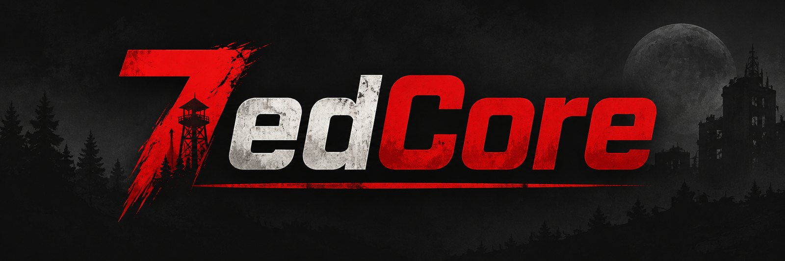
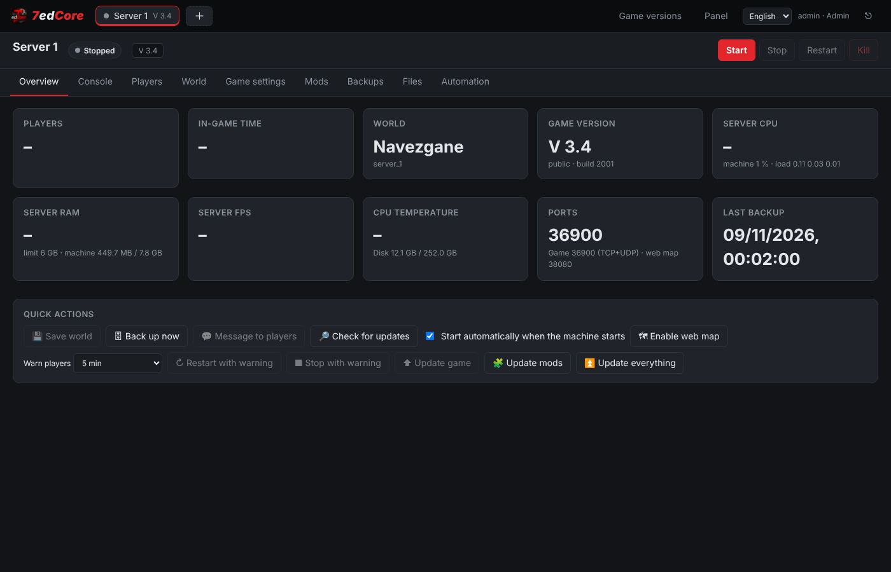
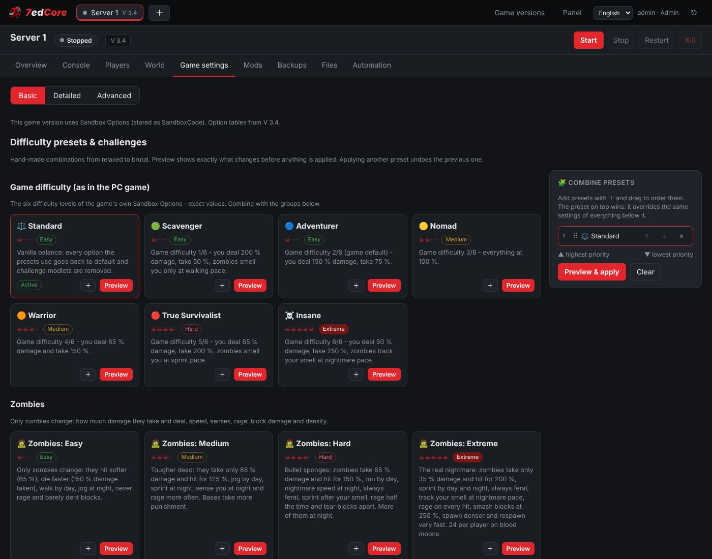

<p align="center"></p>

<p align="center"><b>A self-hosted web panel for 7 Days to Die dedicated servers.</b><br>
Several servers on one machine, each with its own game version, mods, backups and schedule.</p>

<p align="center">
  <a href="https://github.com/Koberecnikos/7edCore/actions"></a>
  <a href="https://github.com/Koberecnikos/7edCore/releases"></a>
</p>

---

## Features

- **Several servers.** Each server gets its own tab and its own ports, saves, mods, backups and schedule. Use the **+** tab to add one.
- **Game version per server.** Pick any Steam branch: `public`, `v3.4.0`, `v2.6`, `alpha21.2`, experimental, and so on. Installs are shared between servers.
- **Save compatibility checks.** 7edCore tracks the game version each save was made with. It warns you before you load a save on a newer version, and it blocks a major-version mismatch or a downgrade unless you confirm it.
- **Updates for the game and mods.**
  - Policies: off, notify, hotfixes only, or hotfixes plus minor updates. Major updates are never installed automatically.
  - Updates are installed only when nobody is online, only while the server is stopped, or at the next scheduled restart.
  - A backup is taken before every update.
- **Mods.**
  - Install from a ZIP, a GitHub repository or a URL.
  - *Find compatible version* picks the newest release made for your game version.
  - Updates keep the files you edited. If the author also changed one of those files, their version is saved next to yours as `*.new`.
- **Game settings in three levels.** Basic covers the world, difficulty, max players and party XP range. Detailed has every gameplay option, grouped by category. Advanced covers networking and permissions.
- **Difficulty presets and challenges.** Night Terrors, Horde Week, Feral Wasteland, Siege Builders, Short Fuse, Hardcore Survivor and Insane Apocalypse. Loot stays at standard values.
- **World management.**
  - Choose a map, generate an RWG world, or switch between saves.
  - Import a single-player world from a ZIP.
  - Export or import a server's config: from your PC, from a file stored on the server, or from another server.
- **Console and players.** Live console with commands. Kick, ban or promote players.
- **Quick actions** for each server: save the world, back up now, restart or stop with an in-game countdown, update the game, mods or everything, and message players.
- **Scheduler.** Start, stop, restart, update and backup rules per weekday. Players get warnings in the in-game chat before a stop or restart.
- **Backups.** Automatic and manual backups, compressed with zstd on a reserved CPU core. A backup is also taken before every restore, update and import.
- **Resources.** RAM limit (warn or restart gracefully), CPU core pinning, crash auto-restart, and a file manager with an editor.
- **Interface.** English and Czech. Logins are remembered for a year, and you set the password on first run.
- **Self-updating.** When a new 7edCore release is published, your server updates itself, but only when nobody is playing.
- **Safe shutdowns and power loss.** Game servers are saved and stopped on shutdown and resumed afterwards. A `7edcore` command line plugs into UPS software, and laptops and mini PCs get battery handling out of the box.

<p align="center"> </p>

## Install

You need Linux on x86_64 with systemd, for example Ubuntu, Debian or Fedora. Plan for about 20 GB of disk per installed game version, and at least 8 GB of RAM.

```bash
curl -fsSL https://raw.githubusercontent.com/Koberecnikos/7edCore/main/install.sh | sudo bash
```

The installer does the following:
- installs Docker if it is missing;
- creates `/opt/7edcore` with `compose.yaml` and a `data/` folder;
- starts the panel;
- enables the 7edCore updater (a systemd timer);
- installs the `7edcore` command;
- enables battery handling if the machine has a battery;
- opens the game ports in ufw or firewalld if either is active.

When it finishes, open `http://<server-ip>:8120` and choose the admin password. The game itself is downloaded from the panel through SteamCMD.

Forward **26900–26903 TCP+UDP** on your router for server 1, 26910–26913 for server 2, and so on. **Do not** expose port 8120 to the internet. Use your LAN or a VPN such as Tailscale instead.

### Manual install (Docker Compose)

```bash
mkdir -p /opt/7edcore/data && chown 1000:1000 /opt/7edcore/data && cd /opt/7edcore
curl -fsSLO https://raw.githubusercontent.com/Koberecnikos/7edCore/main/deploy/compose.yaml
docker compose up -d
```

If you skip the updater, update by hand with `docker compose pull && docker compose up -d`.

## Updates

| What | How |
|---|---|
| **7edCore** | The host updater checks for a new image every 6 hours. It restarts the panel only when nobody is online. Before the restart, every game server is saved and stopped, and servers that were running start again afterwards. You can set this to *auto*, *notify* or *off* under **Panel → 7edCore updates**, or use **Update now**. |
| **Game** | Set per server under **Automation → Updates**. Major versions always need you to confirm. |
| **Mods** | Set per server under **Automation → Updates**, or use **Quick actions → Update mods**. |

## Command line

`install.sh` adds a `7edcore` command on the host, for scripts, cron jobs and UPS software. Inside the container the same command is available as `docker exec 7edcore 7edcore …`.

```
7edcore status [--json]        servers, state, players, game version
7edcore save                   save the world of every running server (no restart)
7edcore stop-all [reason]      save and stop every running server, remember which ones
7edcore resume                 start the servers that stop-all stopped
7edcore start|stop|restart ID  one server (ID from status)
7edcore update                 update 7edCore now
7edcore logs                   follow the panel log
```

Exit codes: `0` means OK, `1` means error, `2` means the panel is not running. `save` still works when the panel is not responding, because it falls back to sending `saveworld` directly to each game server.

## Shutdown, power loss and UPS

7edCore runs the same on a rack server, a desktop PC, a mini PC or a laptop. What happens on shutdown and power loss depends on the hardware.

**Every machine (no extra setup).** On a normal shutdown, reboot or `docker compose down`, the panel saves and stops every game server before it exits. The container gets 5 minutes for this, and `install.sh` raises the Docker service stop timeout to match. When the machine comes back, servers that were running start again. You can change that per server under **Automation → Start with the panel**.

**Machines with a battery** (laptops, mini PCs with a built-in UPS). `install.sh` detects the AC adapter and the battery and enables `7edcore-powerwatch`, a small systemd service:

| Event | Action |
|---|---|
| on battery for 60 s | `7edcore save` |
| on battery for 5 min | `7edcore stop-all` (saved and stopped, remembered across reboots) |
| battery at 15 % | stop-all, then suspend (configurable: `none`, `suspend`, `poweroff`) |
| AC back for 60 s | `7edcore resume` |

The settings are in `/etc/default/7edcore-powerwatch`. To force it on or off when installing, use `SEVENEDCORE_POWERWATCH=1` or `0`.

**Servers with an external UPS.** Hook your UPS software into the same commands. Examples are in [`deploy/ups`](deploy/ups):

- **Network UPS Tools (NUT).** `upssched` timers save after 60 s on battery, run `stop-all` after 5 minutes or on low battery, and `resume` when power is back. Install `nut-upssched.conf` as `/etc/nut/upssched.conf` and `7edcore-upssched-cmd` as `/usr/local/bin/7edcore-upssched-cmd`.
- **apcupsd.** `onbattery` saves, then runs `stop-all` if still on battery after 5 minutes. `offbattery` runs `resume`. `doshutdown` runs `stop-all`.

Keep the UPS host shutdown later than `stop-all`, so the game servers are already saved when the machine powers off.

## Data layout

```
/opt/7edcore/data
├── versions/<branch>/        game installs (shared)
├── instances/<server>/       config, saves (userdata), mods, logs, backups, settings
├── exports/                  config exports kept on the server
├── panel/                    password hash, sessions, update state
└── trash/                    deleted servers
```

## Configuration

These are environment variables in `compose.yaml`:

| Variable | Default | |
|---|---|---|
| `TZ` | host time zone | used by the scheduler and timestamps |
| `MAX_SERVERS` | `4` | each server needs 10 game ports and 1 web map port, so publish the matching ranges |
| `PANEL_PASSWORD` | – | a fixed password instead of first-run setup |
| `GAME_PORT_BASE` / `WEB_PORT_BASE` | `26900` / `8080` | server *k* uses base + 10·k for the game and base + k for the web map |

## Development

```bash
pip install aiohttp psutil playwright
tests/run_server.sh /tmp/7edcore-data 18200        # panel with a fake SteamCMD + fake game server
python3 tests/api_test.py http://127.0.0.1:18200 testpass123
python3 tests/ui_test.py  http://127.0.0.1:18200 testpass123 /tmp/shots
```

The backend is Python and aiohttp, in `app/sevenedcore`. The frontend is plain JS with no build step, in `app/static`. Translations live in `app/static/i18n.js`. To add a language, copy the `en` block.

### Releasing

1. Add a `## 1.1.0 - <date>` section to `CHANGELOG.md`.
2. Push a tag: `git tag v1.1.0 && git push origin v1.1.0`.
3. GitHub Actions runs the tests, publishes `ghcr.io/koberecnikos/7edcore:1.1.0` and `:latest`, and creates the GitHub release from the changelog.
4. Installed servers pick it up automatically.

Every push to `main` also publishes `:edge`, for testing.

## License

The 7edCore Non-Commercial Attribution License is source-available, not open source. See [LICENSE](LICENSE). You may use, modify and share 7edCore for non-commercial purposes, with attribution. For commercial use, contact the author.

7 Days to Die is a trademark of The Fun Pimps. 7edCore is not affiliated with The Fun Pimps or Valve.
